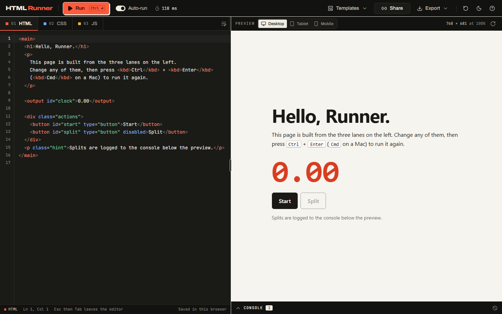
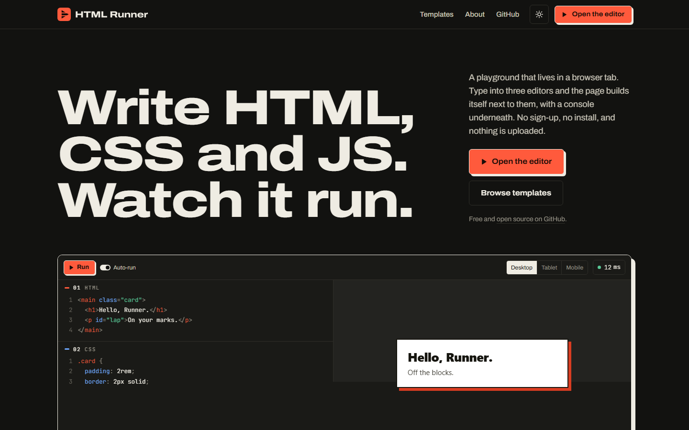

# HTML Runner

Write HTML, CSS and JavaScript in the browser and watch it run. No account, no install, nothing uploaded.

**Live site:** [htmlrunner.h190k.com](https://htmlrunner.h190k.com/) · **Editor:** [htmlrunner.h190k.com/app](https://htmlrunner.h190k.com/app)



## What it does

- **Three editors, one per language.** HTML, CSS and JS each get a lane with syntax highlighting, line numbers and bracket matching (CodeMirror 6).
- **Live preview.** Auto-run refreshes the preview shortly after you stop typing. Turn it off and run by hand with `Ctrl`/`Cmd` + `Enter`. A stopwatch shows how long each run took to render.
- **Device sizes.** Desktop, Tablet (768 × 1024) and Mobile (375 × 667). Frames scale down to fit the pane and show their true dimensions.
- **Console.** `console.log`, warnings and uncaught errors from your page appear in a drawer under the preview.
- **Share links.** The whole project is compressed into the URL hash (`/app#code=...`). Nothing is stored on a server.
- **Export.** Download a `.zip` (`index.html`, `style.css`, `script.js`) or a single self-contained `.html`. `Ctrl`/`Cmd` + `S` downloads the zip.
- **Starter templates.** `hello`, `card`, `clock`, `todo` and `canvas`, each reachable at `/app?template=<id>`.
- **Autosave.** Your work is kept in this browser's `localStorage`.
- **Light and dark themes**, resizable panes, and a stacked layout for phones.



## Privacy and the sandbox

HTML Runner is a static site. There is no backend, no database and no analytics.

Your code runs inside an `<iframe sandbox="allow-scripts allow-modals allow-forms allow-popups">`. `allow-same-origin` is deliberately left out, so the preview gets an opaque origin and cannot read the editor's storage, cookies or DOM. That matters because share links can carry code written by someone else. The preview talks to the editor only through `postMessage`, and console output is rendered as plain text.

## Tech stack

| Concern | Choice |
| --- | --- |
| Framework | [Astro](https://astro.build) 7, static output |
| Interactive island | React 19 |
| Styling | Tailwind CSS v4 with CSS custom-property design tokens |
| UI primitives | shadcn-style components on Radix UI |
| State | nanostores |
| Editor | CodeMirror 6 |
| Zip and share-link compression | fflate |
| Fonts | Archivo and JetBrains Mono, self-hosted via Fontsource |
| Tests | Vitest |
| Hosting | Cloudflare Pages |

The full design and module contracts are in [docs/ARCHITECTURE.md](docs/ARCHITECTURE.md).

## Getting started

Requires Node.js 22 or newer.

```bash
git clone https://github.com/H190K/HTML-wrapper.git
cd HTML-wrapper
npm install
npm run dev
```

| Command | What it does |
| --- | --- |
| `npm run dev` | Start the dev server at `http://localhost:4321` |
| `npm run build` | Type-check with `astro check`, then build to `dist/` |
| `npm run preview` | Serve the built `dist/` locally |
| `npm test` | Run the unit tests |
| `node scripts/brand/build.mjs` | Regenerate favicons, app icons and the social card from the SVG sources |

## Project structure

```
src/
  pages/                 index (landing), app (editor), about, 404
  layouts/Base.astro     head, meta tags, theme bootstrap
  components/
    brand/               logo mark and wordmark
    site/                landing, about and 404 pieces
    playground/          the editor island (React)
  lib/                   framework-free logic with unit tests
                         (preview document, share links, export, storage, templates)
  stores/playground.ts   application state
  styles/                design tokens and page styles
public/                  icons, social card, manifest, robots.txt
scripts/brand/           SVG sources and the asset generator
docs/                    architecture notes and screenshots
```

## Deploying

The site builds to plain static files, so any static host works. On Cloudflare Pages:

| Setting | Value |
| --- | --- |
| Build command | `npm run build` |
| Build output directory | `dist` |
| Node version | 22 (read from `.nvmrc`) |

## Background

HTML Runner started as a project for the SWE402 Internet Programming course, written in plain HTML, CSS and JavaScript. Version 2 is a rebuild on Astro with a real code editor, a safer sandbox, a console, share links and a new design.

## License

[MIT](LICENSE) © [H190K](https://h190k.com)
